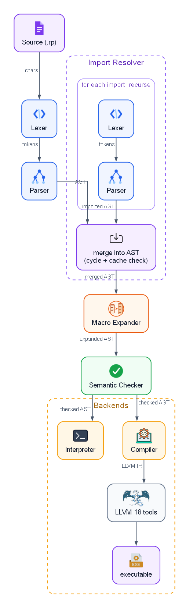

# Raptor

Raptor is a **statically typed, compiled, self-hosted** programming language.
The primary compiler is written in Raptor itself (`selfhost/`) and targets native code via **LLVM 18**.

The language supports mutable variables, block scoping, functions, references, structs, enums with payloads, pattern matching, multidimensional vectors, type conversions, structured control flow, macros, TCP networking, and external libraries (e.g. Raylib).

## What ships in this repo

| Component                                                             | Role                                                                                                                       |
| --------------------------------------------------------------------- | -------------------------------------------------------------------------------------------------------------------------- |
| **Self-hosted compiler** (`selfhost/`, bootstrapped via `bootstrap/`) | Main compiler. Always compiles to LLVM IR (no interpreter).                                                                |
| **`lsp`** (Rust, `src/bin/lsp.rs`)                                    | Language Server Protocol server for editor integration.                                                                    |
| **Rust implementation** (`src/`)                                      | Historical / reference frontend + LLVM backend and interpreter. Still buildable; not the CI default path for the language. |
| **Examples** (`examples/`)                                            | Sample programs (including TCP and Raylib).                                                                                |
| **Stdlib** (`stdlib/`)                                                | Standard library sources used by programs.                                                                                 |

## Table of contents

- [Language pipeline](#language-pipeline)
- [Quick start (self-hosted compiler)](#quick-start-self-hosted-compiler)
- [CLI options](#cli-options)
- [Example program](#example-program)
- [Language overview](#language-overview)
- [Documentation](#documentation)
- [Testing](#testing)
- [LSP](#lsp)
- [LLVM](#llvm)
- [Repository layout](#repository-layout)

## Language pipeline



## Quick start (self-hosted compiler)

### Requirements

- Linux (tested under WSL as well)
- **LLVM 18** tools on `PATH`: `llc-18`, `clang-18` (and `opt-18` when using `-O1`/`-O2`/`-O3`)
  - Override the version suffix with `LLVM_VERSION=19` if needed

### Bootstrap the compiler

From the repository root:

```bash
./bootstrap/bootstrap.sh
```

This links the checked-in IR in `bootstrap/raptor.ll` into `bootstrap/raptor`.
No Rust toolchain is required for this step.

Details: [bootstrap/README.md](bootstrap/README.md).

### Compile and run a program

```bash
# Compile to a native executable under build/
./bootstrap/raptor examples/demo.rp

# Compile and run
./bootstrap/raptor --run examples/demo.rp

# Custom output path
./bootstrap/raptor -o ./build/demo examples/demo.rp

# Reference counting (default) vs leak-everything mode
./bootstrap/raptor --memory arc  examples/demo.rp
./bootstrap/raptor --memory leak examples/demo.rp
```

Artifacts land under `build/` (IR, object file, executable).

### Rebuild the bootstrap IR after changing `selfhost/`

```bash
./bootstrap/raptor ./selfhost/raptor.rp
cp ./build/raptor.ll ./bootstrap/raptor.ll   # path may be out.ll depending on driver; use the IR the compiler wrote
./bootstrap/bootstrap.sh
```

A healthy self-compile reaches a fixpoint (identical IR on repeated compilation). See [bootstrap/README.md](bootstrap/README.md).

## CLI options

Self-hosted `raptor` (mirrors the historical Rust CLI, plus memory mode):

```text
-h, --help          Show this help message
-v, --verbose       Show execution time of each phase
--unsafe            Skip semantic checking
--run               After compiling, build and run the resulting executable
-o <FILE>           Set output executable path
--link <FILE>       Link an additional object file (repeatable)
-O0                 No optimization (default)
-O1                 Basic optimization
-O2                 Default optimization
-O3                 Aggressive optimization
--overflow <POLICY> Integer overflow policy: ignore, warn, error
--memory <MODE>     Memory management of the compiled program: arc (default), leak
```

There is no interpret-only mode in the self-hosted compiler: every successful run produces (and optionally links/runs) native code.

## Example program

```raptor
enum AccountStatus derives Debug {
    Active,
    Suspended(str),
    Deleted(Timestamp)
};

struct Timestamp derives Debug {
    i64 day,
    i64 month,
    i64 year
};

enum Role derives Debug {
    Admin,
    Moderator,
    User
};

struct User derives Debug {
    str name,
    AccountStatus status,
    Role role
};

fn pretty_timestamp(&Timestamp timestamp): str {
    let day = timestamp.day as str;
    if (timestamp.day < 10) day = "0" + timestamp.day as str;

    let month = timestamp.month as str;
    if (timestamp.month < 10) month = "0" + timestamp.month as str;

    return day as str + "-" + month as str + "-" + timestamp.year as str;
}

let users = [
    User {
        name: "Alice",
        status: AccountStatus::Active,
        role: Role::Admin
    },
    User {
        name: "Bob",
        status: AccountStatus::Suspended("too many failed logins"),
        role: Role::User
    },
    User {
        name: "Charlie",
        status: AccountStatus::Deleted(Timestamp { day: 17, month: 9, year: 2026 }),
        role: Role::Moderator
    }
];

let idx = 2;
match (users[idx].status) {
    AccountStatus::Deleted(timestamp) { println(pretty_timestamp(&timestamp)); },
    rest println(account_status_debug(&users[idx].status) + " doesn't contain data of type 'Timestamp'.");
}

if (users[idx].status matches AccountStatus::Deleted(timestamp)) {
    println(pretty_timestamp(&timestamp));
} else {
    println(account_status_debug(&users[idx].status) + " doesn't contain data of type 'Timestamp'.");
}

for (let i = 0; i < vector_size(&users); i += 1) {
    println(user_debug(&users[i]));
}
```

```bash
./bootstrap/raptor --run examples/demo.rp
```

## Language overview

Raptor currently supports:

- integer types `i8`/`i16`/`i32`/`i64`, `u8`/`u16`/`u32`/`u64`, plus `f64`, `str`, `bool`, `char`, and `void`;
- mutable variables with block-based scoping;
- functions and recursion;
- parameters passed by value or by reference (`&`);
- structs and enums (unit and payload variants), including `derives`;
- pattern matching with `match` and `if`/`while` … `matches`;
- `if`, `for`, `while`, and `switch`;
- `break`, `continue`, and `return`;
- arithmetic, comparison, and logical operators;
- explicit casts with `as`;
- vectors, including multidimensional types such as `i64[][]`;
- macros and imports;
- `extern` functions for C ABI interop;
- networking helpers (`tcp_listen`, `tcp_accept`, `tcp_connect`, `tcp_read`, `tcp_write`, `tcp_close`);
- built-ins such as `print` / `println`, `input`, vector operations, file helpers, etc.

### Structs

```raptor
struct User {
    str name,
    i64 age,
    bool active
};

let user = User {
    name: "Alice",
    age: 30,
    active: true
};

println(user.name);
```

Structs may nest other structs, vectors, and enums, and may be passed by value or by reference.

### Enums

```raptor
enum AccountStatus {
    Active,
    Suspended(str),
    Deleted
};

let suspended = AccountStatus::Suspended("too many failed logins");

fn status_repr(&AccountStatus status): str {
    match (status) {
        AccountStatus::Active { return "active"; },
        AccountStatus::Suspended(reason) { return "suspended: " + reason; },
        AccountStatus::Deleted { return "deleted"; }
    }
}
```

### Vectors

```text
i64[]     # one-dimensional vector
i64[][]   # two-dimensional vector
i64[][][] # three-dimensional vector
```

Passing a vector **by value** performs a **shallow copy** of the vector header; composite elements are shared via reference counts (in `arc` mode).

### Memory management

Compiled programs default to **automatic reference counting** (`--memory arc`) for `str`, vectors, structs, and enums. There is no manual `free` and no GC pause. Cycles are not collected.

`--memory leak` disables refcounting (allocations are never freed) — useful for short-lived tools and for comparing behaviour.

See [docs/memory-management.md](docs/memory-management.md).

## Documentation

| Topic                        | Document                                               |
| ---------------------------- | ------------------------------------------------------ |
| Grammar                      | [docs/grammar.md](docs/grammar.md)                     |
| Lexer                        | [docs/lexer.md](docs/lexer.md)                         |
| Parser                       | [docs/parser.md](docs/parser.md)                       |
| Semantic checker             | [docs/semantic-checker.md](docs/semantic-checker.md)   |
| Compiler / LLVM pipeline     | [docs/compiler.md](docs/compiler.md)                   |
| Memory management            | [docs/memory-management.md](docs/memory-management.md) |
| Bootstrap / self-host        | [bootstrap/README.md](bootstrap/README.md)             |
| Interpreter (Rust reference) | [docs/interpreter.md](docs/interpreter.md)             |

## Testing

CI builds the self-hosted compiler and runs the self-host test suite under ARC:

```bash
./bootstrap/bootstrap.sh
python3 ./selfhost/tests/test_runner.py run \
  --compiler ./bootstrap/raptor \
  --memory arc
```

The same runner can target either compiler implementation and supports filters, valgrind, and IR diffs. See the header comment in `selfhost/tests/test_runner.py`.

## LSP

The language server is still built with Rust:

```bash
cargo build --release --bin lsp
./target/release/lsp
```

It is a separate executable from the Raptor compiler and does not use the compiler CLI above.

## LLVM

Native codegen targets **LLVM 18** (`llc-18`, `clang-18`, optionally `opt-18`).
These tools must be on `PATH` (or selected via `LLVM_VERSION`).

## Repository layout

```text
bootstrap/          # Checked-in IR + script to produce bootstrap/raptor
selfhost/           # Compiler written in Raptor (frontend, checker, LLVM backend)
src/                # Rust reference implementation + LSP
stdlib/             # Standard library
examples/           # Example programs and small projects
docs/               # Language and pipeline documentation
selfhost/tests/     # End-to-end test runner and cases
```

## Errors and diagnostics

Diagnostics use a compact compiler-style format:

```text
error: <message>
  --> <file>:<line>:<column>
```

Stages that report errors: lexer, parser, semantic checker, and the LLVM / link pipeline.
