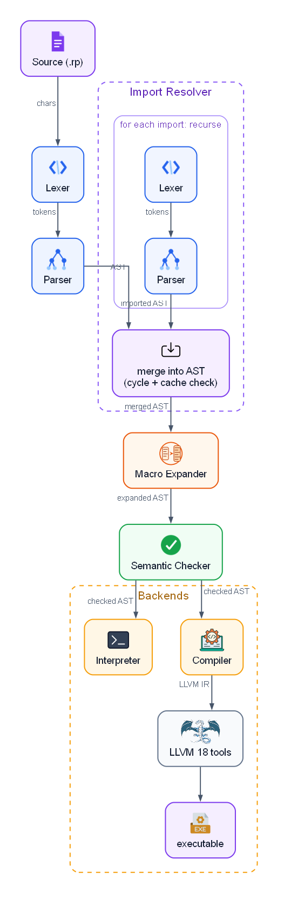

# Compiler

Raptor compiles programs to native code through **LLVM 18**.

The compiler implementation lives entirely under **`src/`** as Raptor sources (entry point `src/raptor.rp`). It is bootstrapped from checked-in IR in `bootstrap/raptor.ll`. There is no separate Rust compiler pipeline on `master`.

## libc-only runtime

| Stage                                 | Dependency                                                                                                       |
| ------------------------------------- | ---------------------------------------------------------------------------------------------------------------- |
| **Running `bootstrap/raptor`**        | **libc** only (native executable)                                                                                |
| **Running a program built by Raptor** | **libc** only by default; extra libs only if you pass `--link`                                                   |
| **Compiling** (driver side)           | Needs `llc` / `clang` (and optionally `opt`) installed — these are host tools, not linked into the output binary |

IR declares libc symbols explicitly (`src/backend/llvm/libc-decls.rp`): `malloc`, `free`, `realloc`, `printf`, file and socket APIs, and so on. The ARC runtime is a thin layer over those allocators.

## Responsibilities

The compiler:

1. receives a checked (or `--unsafe`) AST after lexing, parsing, import resolution, and macro expansion;
2. lowers the program to **textual** LLVM IR;
3. writes IR under `build/`;
4. invokes `llc` (object file) and `clang` (link), optionally `opt` when `-O1`/`-O2`/`-O3` is set;
5. optionally runs the resulting executable (`--run`).

## Pipeline



```text
Lexer → Parser → Import resolver → Macro expander → Semantic checker → LLVM IR → llc → clang → executable
```

## Backend layout

Sources under `src/backend/llvm/`:

| File / area                                         | Role                                       |
| --------------------------------------------------- | ------------------------------------------ |
| `ir-builder.rp`                                     | Textual IR buffer helpers                  |
| `libc-decls.rp`                                     | `declare` lines for libc / runtime         |
| `types-ir.rp`                                       | Type lowering                              |
| `expressions.rp` / `statements.rp` / `functions.rp` | AST → IR                                   |
| `arc.rp`                                            | Retain/release helpers when `--memory arc` |
| `compiler.rp` / `compiler-core.rp`                  | Orchestration                              |

## LLVM version

Default tool version is **18**:

```text
llc-18 / llc
clang-18 / clang
opt-18 / opt   (when an -O level is requested)
```

## Output files

Default directory:

```text
build/
```

Typical artifacts for `basic.rp`:

```text
build/basic.ll
build/basic.o
build/basic          # executable (libc-linked)
```

Override the executable path with `-o`.

## Optimization

```text
-O0    No optimization (default)
-O1    Basic
-O2    Default optimization pipeline
-O3    Aggressive
```

Applied via `opt` before `llc` when requested.

## Memory mode

```text
--memory arc    Reference counting (default)
--memory leak   malloc only; nothing freed
```

See [memory-management.md](memory-management.md).

## Integer overflow

```text
--overflow ignore   (default)
--overflow warn
--overflow error
```

Non-`ignore` policies use LLVM overflow intrinsics for checked arithmetic.

## Compile and run

```bash
./bootstrap/raptor examples/basic.rp
./bootstrap/raptor --run examples/basic.rp
./bootstrap/raptor -o ./build/basic -O2 --run examples/basic.rp
```

`--run` compiles, links, then executes. The process image still only needs **libc** at runtime.

## External libraries

```bash
./bootstrap/raptor --link /path/to/libfoo.a myprog.rp
```

`extern fn` declarations in source describe the C ABI; `--link` supplies the objects at link time.

## Networking

TCP helpers (`tcp_listen`, `tcp_accept`, `tcp_connect`, `tcp_read`, `tcp_write`, …) lower to libc socket calls (`socket`, `bind`, `listen`, `accept`, `connect`, `recv`, `send`, `close`, …).
